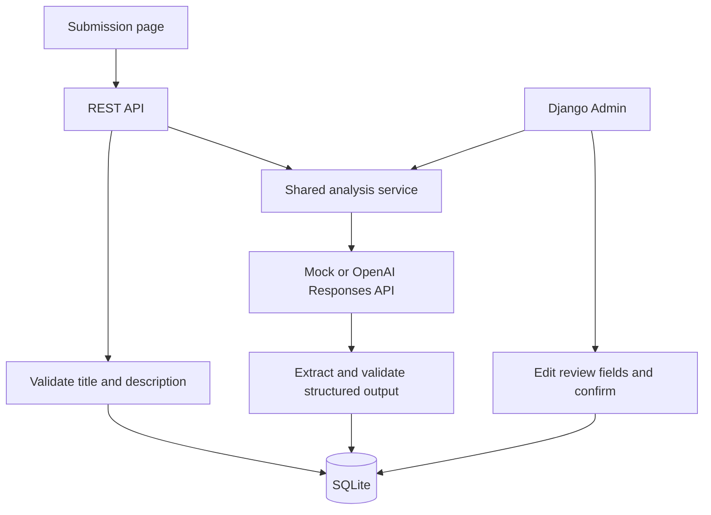
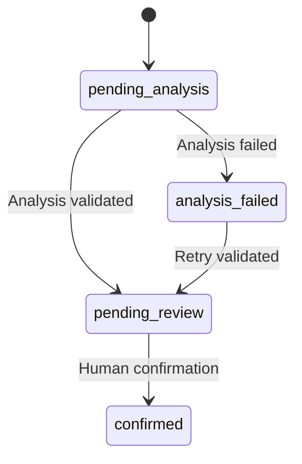

# Architecture

The application uses a Django REST API for ticket submission and retrieval, a shared analysis service for AI processing, and Django Admin for human review. The submission page calls the same API as other clients.

## Request flow

1. `TicketSerializer` validates incoming title and description.
2. The API view saves the ticket in `pending_analysis` before requesting analysis.
3. The service selects the analysis provider using `TICKET_AI_MODE`.
4. The OpenAI request specifies a strict JSON Schema. The response parser extracts the generated JSON, and `TicketAnalysisSerializer` validates the four analysis fields.
5. Validated output is saved to `ai_result`, copied into editable review fields, and assigned `pending_review`.
6. Expected provider or validation failures set `analysis_failed` while retaining the ticket. Admin can retry the same ticket.

Analysis runs synchronously within the request. `201 Created` reports successful ticket persistence; the returned `status` reports the analysis outcome. The HTTP client uses a 20-second network timeout.

## State transitions

Analysis accepts pending or failed tickets. Confirmation accepts only pending-review tickets with all four review fields completed. API-created tickets are analyzed automatically; Admin-created tickets require the analysis action.

## Data and review

`Ticket` stores the input, status, original AI analysis, human-review fields, and analysis metadata in SQLite through Django ORM and migrations.

- `ai_result` contains category, priority, summary, and suggested reply. It is read-only in Admin.
- `reviewed_category`, `reviewed_priority`, `reviewed_summary`, and `reviewed_reply` contain editable review values. Confirmation preserves the original analysis.
- `analysis_model`, `analysis_prompt_version`, and `analyzed_at` identify the latest successful analysis. The model field records the requested model name.

Reviewers edit and save the fields before using **Confirm selected tickets**. Confirmed replies are stored in the database. The submission page renders model text with `textContent` and labels replies as drafts.

## Components

| Component | Responsibility |
| --- | --- |
| `config/urls.py` and `tickets/urls.py` | Route homepage, Admin, and API requests |
| `tickets/models.py` and migrations | Define and evolve the database schema |
| `tickets/serializers.py` | Validate API input and analysis output; serialize ticket responses |
| `tickets/views.py` | Persist API submissions, invoke analysis, handle expected failures, and render the homepage |
| `tickets/services.py` | Share provider selection, state checks, output validation, and result persistence |
| `tickets/llm.py` | Construct schema-constrained requests, parse responses, and report provider errors |
| `tickets/admin.py` | Provide review editing, confirmation, retry, and metadata inspection |
| `tickets/templates/` and `tickets/static/` | Provide the submission form, styling, and API interaction |

## Validation and operations

Provider-side JSON Schema constrains output structure. Backend validation checks required fields, allowed categories and priorities, and non-empty summary and reply text before persistence. Human review checks the content and proposed actions.

The LLM adapter handles HTTP errors, connection errors, invalid JSON, incomplete output, and refusals. Application logs record analysis outcomes with ticket IDs. API credentials are read from the server environment.

Django Admin uses Django's administrator authentication. API endpoints currently accept unauthenticated local requests. The setup instructions bind the development server to localhost.

Fixed examples and targeted prompt regressions are documented in [Evaluation](EVALUATION.md).
