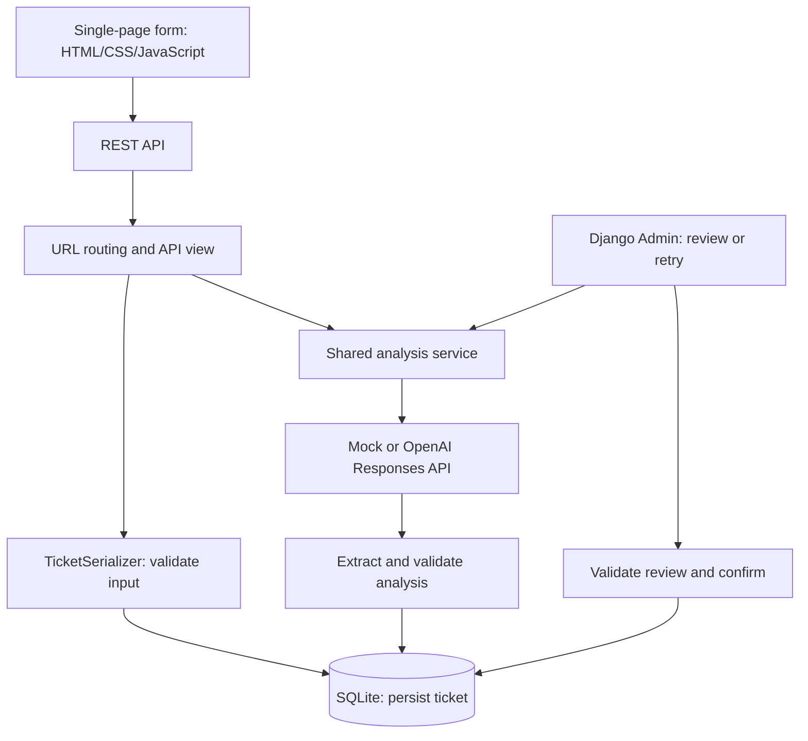

# Demo 与面试说明 / Demo and Interview Guide

## 项目介绍 / Project introduction

这是一个轻量的 Django 工单流程：用户通过 REST API 提交问题，后端先保存工单，再调用 LLM 生成结构化建议，最后由人工审核并确认。重点是数据库持久化、LLM 输出验证、失败恢复和可追溯性。回复只保存，不发送给客户。

This lightweight Django workflow accepts support tickets through a REST API, persists them before calling an LLM, and generates structured suggestions for human review. It demonstrates persistence, validated LLM integration, recovery from expected failures, and traceability. Replies are saved rather than sent to customers.

## 三分钟演示 / Three-minute walkthrough

1. **提交 / Submit:** 在真实模式下打开首页 `/`，填写下方样例并点击 Analyze ticket。说明 mock 模式也能在没有 key 的情况下演示流程。 / Open `/` in real mode, enter the sample below, and click Analyze ticket. Explain that mock mode supports running the workflow without credentials.
2. **查看分析 / Inspect analysis:** 展示工单编号、Pending review 和四个分析字段。首页调用现有 REST API；若展示接口，说明 `201 Created` 表示工单创建成功，分析是否成功由状态决定。 / Show the ticket ID, Pending review, and the four analysis fields. The page calls the existing REST API; if showing the API, explain that 201 confirms creation while status reports the analysis outcome.
3. **人工审核 / Human review:** 点击 Review this ticket，在 Admin 查看原始建议、模型、prompt 版本和时间。检查是否有无依据的承诺，修改回复并保存，再在列表执行 Confirm selected tickets。 / Click Review this ticket, inspect the original suggestion and metadata in Admin, check for unsupported commitments, edit and save the reply, then select Confirm selected tickets from the list.
4. **结果追溯 / Traceability:** 展示 `confirmed` 状态，以及分开保存的原始 AI 建议和人工结果。 / Show the confirmed state and the separately stored original and reviewed results.
5. **评估 / Evaluation:** 打开 `EVALUATION.md`，说明五条 v1 样例的结果，以及两条 v2 针对性回归。 / Open `EVALUATION.md` and explain the five-case v1 baseline and two targeted v2 regression checks.

**Title:** Charged twice for my monthly subscription

**Description:** My monthly subscription costs $20, but I noticed two $20 charges on my card today. My account still works normally. Could you check whether one of the charges was a mistake and explain how I can request a refund?

真实模型 v2 的预期是 billing / medium；mock 固定返回 other / medium，用于验证工程流程，不用于衡量模型分类能力。

The expected real-model v2 labels are billing / medium. Mock returns other / medium deterministically to exercise the workflow, not to measure classification quality.

### 可选失败演示 / Optional failure demonstration

临时在真实模式下移除当前终端的 key，重启服务器并提交测试工单。返回应为 `201 Created`，状态为 `analysis_failed`，标题和描述仍保留。恢复 key、重启后，在 Admin 对同一工单执行分析重试。不要展示密钥或包含密钥的截图。

Temporarily remove the key from the current terminal in real mode, restart the server, and submit a test ticket. Expect `201 Created` with `analysis_failed` while retaining the title and description. Restore the key, restart, and retry the same ticket in Admin. Keep credentials out of the demonstration and screenshots.

## 架构与职责 / Architecture and responsibilities

| 文件 / File | 职责 / Responsibility |
| --- | --- |
| `models.py` + migrations | 定义并管理数据库结构 / Define and evolve the database schema |
| `serializers.py` | 验证 API 输入与分析输出，转换 API 数据 / Validate input and analysis; serialize API data |
| `views.py` | 接收请求，先保存，再分析，处理预期失败 / Handle requests, persist first, analyze, handle expected failures |
| `services.py` | 共享分析入口、状态检查、验证及结果保存 / Share analysis, state checks, validation, and persistence |
| `llm.py` | HTTP 请求、JSON Schema、响应提取和调用错误 / Handle HTTP, JSON Schema, response extraction, and provider errors |
| `admin.py` | 人工修改、确认、失败重试和只读追溯信息 / Provide human editing, confirmation, retry, and read-only metadata |
| `templates/tickets/demo.html` + `static/tickets/demo.css` / `demo.js` | 提交界面、样式及 API 调用；安全显示模型文字 / Provide the submission page, styling, and API calls; render model text safely |

## 设计选择 / Design choices

- **Django + DRF:** 复用 ORM、迁移、Admin 和通用 API view，把时间投入到 LLM 集成。 / Reuse ORM, migrations, Admin, and generic views to focus effort on LLM integration.
- **SQLite:** 满足本地 Demo 的持久化需求，启动简单。 / Keep local persistence easy to run.
- **简单前端 / Small frontend:** Django 模板配合 CSS 和原生 JavaScript，调用已有 API，避免增加独立构建流程；人工审核继续使用 Admin。 / Use a Django template, CSS, and plain JavaScript against the existing API to keep setup small; review remains in Admin.
- **同步分析 / Synchronous analysis:** 单个请求完成清晰流程；代价是提交需等待模型响应。若需要更多并发，再考虑后台任务。 / Keep the flow within one request, with submission latency as the tradeoff. Background jobs would be a future concurrency improvement.
- **双重约束 / Two validation layers:** 提供商的 JSON Schema 约束输出结构，DRF 验证保存边界。两者都不能保证业务判断正确，因此保留人工审核和评估。 / Provider-side JSON Schema constrains structure, while DRF validates the persistence boundary. Neither guarantees correct judgment, so evaluation and human review remain necessary.
- **先保存 / Persist first:** 分析失败也保留用户输入；重试复用同一工单。 / Preserve user input when analysis fails and reuse the ticket on retry.

## 面试介绍 / Interview pitch

“我做了一个 Django REST API 工单 Demo，将真实 LLM 集成到完整的后端流程。工单先入库，模型按 JSON Schema 返回建议，后端验证后保存，再交给人工确认。我处理了预期调用失败和手动重试，记录模型、prompt 版本及分析时间。通过固定样例发现优先级和回复承诺的问题后，我修改了 prompt，并保留前后结果进行回归比较。”

“I built a Django REST API demo that integrates an LLM into a complete support-ticket workflow. Tickets are persisted before analysis. The model produces schema-constrained suggestions, which the backend validates and saves for human confirmation. I implemented expected-failure handling, manual retry, and model and prompt metadata. Fixed evaluation cases revealed priority and unsupported reply commitments, so I revised the prompt and preserved the before-and-after results for targeted regression checks.”

## 展示边界 / Practical limits

这是本地 Demo。客服用户权限、分页、调用限流、后台队列和真实回复发送尚未实现。Admin 使用 Django 自带的管理员登录。追溯字段记录最近一次成功分析的请求模型名称，不是完整尝试历史或提供商实际解析的模型快照。评估样例很小，v2 只重测两条，不能声称生产准确率。

This is a local demo. Customer authorization, pagination, rate limiting, background queues, and reply delivery are not implemented. Admin uses Django's built-in administrator login. Metadata identifies the latest successful analysis and requested model, not a complete attempt history or resolved provider snapshot. The evaluation is small and v2 reruns only two cases; it does not establish production accuracy.
