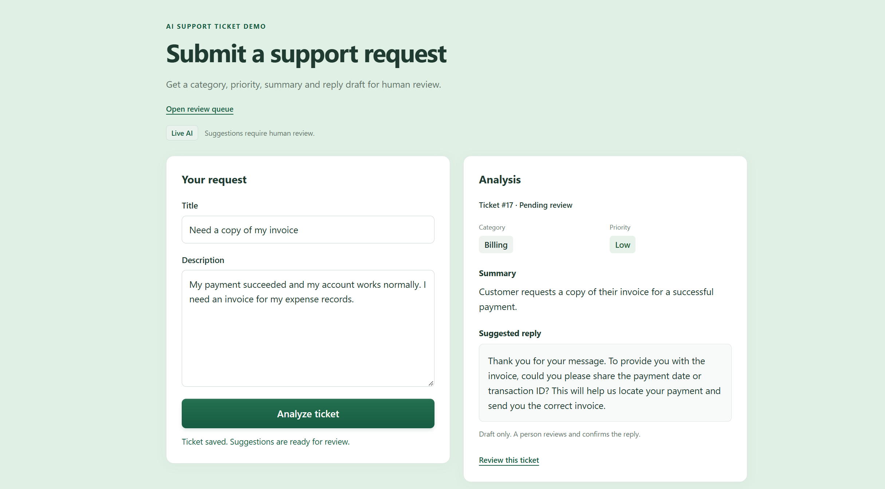

# AI Support Ticket Demo

A small support-ticket workflow that demonstrates backend engineering and practical LLM integration. A customer submits a ticket, the backend saves it and asks an LLM for a structured analysis, and a human reviews and confirms the result.

For current implementation progress and the bilingual build walkthrough, see [Development Log / 开发记录](DEVELOPMENT_LOG.md).

For the demonstration script, architecture, and interview explanation, see [Demo Guide / 演示与面试说明](DEMO_GUIDE.md).

Build stages 1–7 are implemented, including a single-page submission interface and bilingual interview documentation. The API, persistence, real-model integration, human review, manual retry, analysis metadata, and simple evaluation form one complete local demo.



## MVP goal

Complete one reliable end-to-end workflow in one week. The AI assists a human; it does not make or send the final customer-facing response on its own.

## User flow

1. Submit a title and description on the homepage, which calls the REST API.
2. Save the ticket before starting AI analysis.
3. Ask the LLM for a category, priority, short summary, and suggested reply.
4. Validate the structured result, then save it with the ticket.
5. A human opens the ticket in Django Admin, reviews and edits the suggestion, then confirms it.
6. Save the confirmed category, priority, summary, and reply. The reply is not sent to the customer.

If analysis fails, keep the ticket, record the failure, show an analysis-failed state, and allow a human to retry it.

## MVP scope

- REST endpoints to create tickets and retrieve a ticket list and ticket details.
- Persistent ticket, AI suggestion, and human-confirmed result data.
- One LLM request per analysis, with validated structured output.
- Django Admin as the human review interface.
- A responsive submission page with loading feedback, analysis results, failure messages, and a link to human review.
- Basic application logging and clear handling of invalid model output and provider errors.
- Traceability for the model, prompt version, analysis time, and original AI suggestion.
- A small fixed evaluation set of 5–10 sample tickets to check output shape and expected category/priority.

### Categories and priorities

Categories: `account`, `billing`, `technical`, `other`.

Priorities: `low`, `medium`, `high`. Judge priority by the user's practical impact; urgent wording alone does not make a ticket high priority.

### Ticket states

`pending_analysis` → `pending_review` → `confirmed`, with `analysis_failed` for unsuccessful analysis. A failed ticket can be retried.

## Explicitly out of scope

- Customer accounts, customer authorization, and multi-tenant support. Admin uses Django's built-in administrator login.
- Sending replies or integrating with email, chat, Zendesk, or Intercom.
- Knowledge bases, retrieval-augmented generation, or vector databases.
- Multiple agents, tools, or complex orchestration.
- Automatic assignment, SLA management, notifications, and analytics dashboards.
- React, a separate frontend build pipeline, and a custom review dashboard. The small submission page is served by Django; review stays in Admin.

## Technology choices

- **Backend/API:** Python, Django, Django REST Framework.
- **Frontend:** A Django template, plain CSS, and JavaScript `fetch`; no separate build or frontend dependencies.
- **Database:** SQLite, accessed through Django ORM and migrations.
- **Human review:** Django Admin.
- **LLM:** OpenAI Responses API with `gpt-4.1-mini`, called through Python's standard-library HTTP client. A deterministic mock remains available for local development. The application does not require the OpenAI SDK.
- **Structured output:** Request strict JSON Schema output for `category`, `priority`, `summary`, and `suggested_reply`; validate the result with a DRF serializer before saving.
- **Logging/errors:** Use Django's standard logging. Record analysis outcomes and provider/validation failures without logging secrets. Preserve the ticket on failure and support manual retry.
- **Human-in-the-loop:** Keep AI suggestions separate from human-confirmed values. Confirmation is an explicit human action in Admin.

## Traceability and evaluation

Successful analyses store the requested model name, prompt version, and completion time alongside the original suggestion. These fields are read-only in Admin. Historical tickets without recorded metadata retain empty values. The fields describe the latest successful analysis, not a complete attempt history or the provider's resolved model snapshot.

The [bilingual evaluation record](EVALUATION.md) contains five fixed cases and expected labels. Prompt v1 produced 5/5 valid outputs, 5/5 category matches, and 4/5 priority matches. Human review also identified unsupported reply commitments. Prompt v2 adds explicit priority and reply rules; two targeted regression cases passed structure and label checks. The remaining three cases have not been rerun with v2, and these small-sample results do not establish production accuracy.

## Run locally on Windows

From the project directory in PowerShell:

```powershell
python -m venv .venv
.\.venv\Scripts\python.exe -m pip install -r requirements.txt
.\.venv\Scripts\python.exe manage.py migrate
.\.venv\Scripts\python.exe manage.py createsuperuser
.\.venv\Scripts\python.exe manage.py runserver
```

Mock mode is the default and needs no API key. For real analysis, stop the server and run the following in the same terminal:

```powershell
# Read the key without displaying it or including it in a command.
$ticketApiKey = Read-Host "Paste API key" -AsSecureString
$env:OPENAI_API_KEY = [System.Net.NetworkCredential]::new("", $ticketApiKey).Password
$env:TICKET_AI_MODE = "openai"
.\.venv\Scripts\python.exe manage.py runserver
```

Environment variables apply to the current terminal and programs started from it. Real requests require an API key with available credits and incur API usage charges.

Open `http://127.0.0.1:8000/` to submit a ticket. The page identifies mock or live mode. **Review this ticket** opens the saved ticket in Admin, where the administrator login is required. Mock returns fixed sample suggestions, so it demonstrates the workflow rather than classification quality.

## Current API behavior

- `POST /api/tickets/`: submit `title` and `description`. Save the ticket first, then analyze synchronously. `201 Created` means the ticket was persisted; inspect `status` to determine the analysis outcome.
- `GET /api/tickets/`: return tickets, newest first.
- `GET /api/tickets/{id}/`: return one ticket.

The API returns `status` and `ai_result` as read-only fields. A successful analysis sets `pending_review`; an expected analysis failure sets `analysis_failed`. In Admin at `/admin/tickets/ticket/`, select **Analyze selected tickets** to retry a failed ticket. Edit and save the review fields before selecting **Confirm selected tickets**.

API-created tickets are analyzed automatically. Admin-created tickets start in `pending_analysis` and require the analysis action. The HTTP client uses a 20-second network timeout; analysis runs within the request, so submission waits for it.

## One-week build plan

Keep each day focused on one small result; move on only when the current slice works.

1. **Day 1 — Project setup:** Create the Django project and app, configure DRF and SQLite, and make the first migration.
2. **Day 2 — Ticket API:** Define the ticket data model and implement ticket creation, list, and detail endpoints.
3. **Day 3 — Review workflow:** Add statuses and AI/review fields; make tickets usable in Django Admin for human review and confirmation.
4. **Day 4 — AI boundary:** Implement mock analysis, fixed-schema validation, and failure state/retry behavior.
5. **Day 5 — Real LLM:** Connect one provider if an API key is available; keep the mock usable for local development.
6. **Day 6 — Traceability and evaluation:** Store model/prompt metadata and original suggestions; run the 5–10 sample-ticket evaluation and fix obvious issues.
7. **Day 7 — Interview readiness:** Write setup and API documentation, prepare a short demo flow, explain architecture and limitations, and add a small submission page after the backend is complete.

If time gets tight, finish the end-to-end backend flow and Admin review before adding any UI.

## Definition of done

- A ticket can be submitted through the API and remains saved if AI analysis fails.
- Successful analysis produces validated values from the allowed category and priority sets.
- A human can review, edit, and confirm a suggestion in Django Admin.
- The original AI suggestion and confirmed result can be distinguished and inspected later.
- The evaluation examples and a repeatable demo flow are documented.
- The homepage submits to the existing API and displays the saved ticket and analysis outcome.
